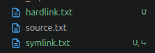
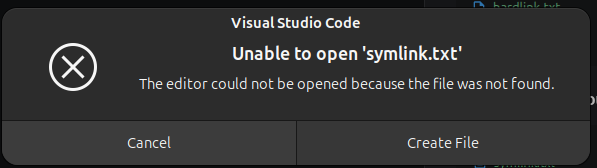
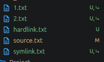
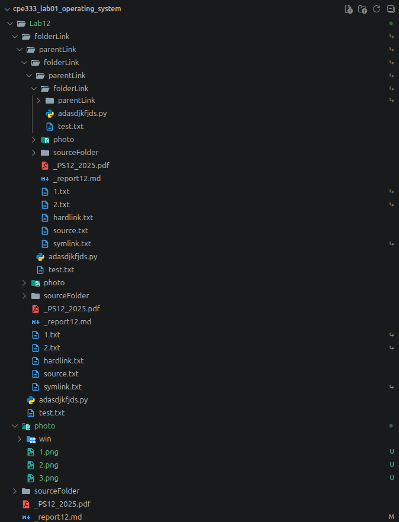

# Lab 12: File System and Implementation

## 12.1: Symbolic and hard Link


### Linux

#### `ln --help`

```bash
Make links between files.

Usage: ln [OPTION]... [-T] TARGET LINK_NAME
       ln [OPTION]... TARGET
       ln [OPTION]... TARGET... DIRECTORY
       ln [OPTION]... -t DIRECTORY TARGET...

Arguments:
  <files>...  

Options:
      --backup[=<CONTROL>]            make a backup of each existing destination file
  -b                                  like --backup but does not accept an argument
  -f, --force                         remove existing destination files
  -i, --interactive                   prompt whether to remove existing destination files
  -n, --no-dereference                treat LINK_NAME as a normal file if it is a
                                      symbolic link to a directory
  -L, --logical                       follow TARGETs that are symbolic links
  -P, --physical                      make hard links directly to symbolic links
  -s, --symbolic                      make symbolic links instead of hard links
  -S, --suffix <SUFFIX>               override the usual backup suffix
  -t, --target-directory <DIRECTORY>  specify the DIRECTORY in which to create the links
  -T, --no-target-directory           treat LINK_NAME as a normal file always
  -r, --relative                      create symbolic links relative to link location
  -v, --verbose                       print name of each linked file
  -h, --help                          Print help
  -V, --version                       Print version

In the 1st form, create a link to TARGET with the name LINK_NAME.
In the 2nd form, create a link to TARGET in the current directory.
In the 3rd and 4th forms, create links to each TARGET in DIRECTORY.
Create hard links by default, symbolic links with --symbolic.
By default, each destination (name of new link) should not already exist.
When creating hard links, each TARGET must exist. Symbolic links
can hold arbitrary text; if later resolved, a relative link is
interpreted in relation to its parent directory.

The backup suffix is '~', unless set with --suffix or SIMPLE_BACKUP_SUFFIX.
The version control method may be selected via the --backup option or through
the VERSION_CONTROL environment variable.  Here are the values:

  none, off       never make backups (even if --backup is given)
  numbered, t     make numbered backups
  existing, nil   numbered if numbered backups exist, simple otherwise
  simple, never   always make simple backups
```

#### Create hard/soft links

- soft: `ln -s source.txt symlink.txt`
- hard: `ln source.txt hardlink.txt`



##### After delete the source file



- hardlink.txt still works.
- symlink.txt cannot access its deleted target and are now unaccesable.

#### Create level 1 and create level 2 link

- level1: `ln -s source.txt 1.txt`
- level2: `ln -s 1.txt 2.txt`



##### After delete the source file

Both level 1 and 2 link are now unaccesable.

##### After delete level 1 link

Level 2 link is now unaccesable.

#### Create a link to directory or folder.

`ln -s folderA folderLink`

#### Create a link that create a loop back to upper-level folder.

`ln -s .. folderA/parentLink`


`ls -R`

```bash
.:
1.txt  2.txt  _PS12_2025.pdf  _report12.md  folderLink  hardlink.txt  photo  source.txt  sourceFolder  symlink.txt

./photo:
1.png  2.png  3.png  4.png  win

./photo/win:
winDelSource1.png  winFolder.png  winLoop.png  winLv.png  windowLink1.png

./sourceFolder:
adasdjkfjds.py  parentLink  test.txt
```

### Window

#### `mklink`

```bash
Creates a symbolic link.

MKLINK [[/D] | [/H] | [/J]] Link Target

        /D      Creates a directory symbolic link.  Default is a file
                symbolic link.
        /H      Creates a hard link instead of a symbolic link.
        /J      Creates a Directory Junction.
        Link    Specifies the new symbolic link name.
        Target  Specifies the path (relative or absolute) that the new link
                refers to.
```

#### Create hard/soft links

- soft: `mklink symlink.txt source.txt`
- hard: `mklink /H hardlink.txt source.txt`


##### After delete the source file


- hardlink.txt still works.
- symlink.txt cannot access its deleted target and are now unaccesable.

#### Create level 1 and create level 2 link

- level1: `mklink 1.txt source.txt`
- level2: `mklink 2.txt 1.txt`


##### After delete the source file

Both level 1 and 2 link are now unaccesable.

##### After delete level 1 link

Level 2 link is now unaccesable.

#### Create a link to directory or folder.

`mklink /D folderLink sourceFolder`


#### Create a link that create a loop back to upper-level folder.

`mklink /D sourceFolder\parentLink ..`


`dir /s`

```bash
 Directory of D:\KMUTT\Year 3\Operating System\Lab12\folderLink\parentLink\folderLink\parentLink\folderLink\parentLink\folderLink\parentLink\folderLink\parentLink\folderLink\parentLink\folderLink\parentLink\folderLink\parentLink\folderLink\parentLink\folderLink\parentLink\folderLink\parentLink\folderLink\parentLink\folderLink\parentLink\folderLink\parentLink\folderLink\parentLink\folderLink\parentLink\folderLink\parentLink\folderLink\parentLink\folderLink\parentLink\folderLink\parentLink\folderLink\parentLink\folderLink\parentLink\folderLink\parentLink\folderLink\parentLink\folderLink\parentLink\sourceFolder\parentLink\folderLink\parentLink\folderLink\parentLink\folderLink\parentLink\sourceFolder\parentLink\sourceFolder\parentLink\sourceFolder\parentLink\folderLink

06-Nov-26  21:33    <DIR>          .
06-Nov-26  21:34    <DIR>          ..
06-Nov-26  21:31                 0 adasdjkfjds.py
06-Nov-26  21:33    <SYMLINKD>     parentLink [..]
06-Nov-26  21:29                33 test.txt
               2 File(s)             33 bytes

 Directory of D:\KMUTT\Year 3\Operating System\Lab12\folderLink\parentLink\folderLink\parentLink\folderLink\parentLink\folderLink\parentLink\folderLink\parentLink\folderLink\parentLink\folderLink\parentLink\folderLink\parentLink\folderLink\parentLink\folderLink\parentLink\folderLink\parentLink\folderLink\parentLink\folderLink\parentLink\folderLink\parentLink\folderLink\parentLink\folderLink\parentLink\folderLink\parentLink\folderLink\parentLink\folderLink\parentLink\folderLink\parentLink\folderLink\parentLink\folderLink\parentLink\folderLink\parentLink\folderLink\parentLink\folderLink\parentLink\sourceFolder\parentLink\folderLink\parentLink\folderLink\parentLink\folderLink\parentLink\sourceFolder\parentLink\sourceFolder\parentLink\sourceFolder\parentLink\folderLink\parentLink

06-Nov-26  21:34    <DIR>          .
06-Nov-26  21:17    <DIR>          ..
06-Nov-26  21:30    <SYMLINKD>     folderLink [sourceFolder]
06-Nov-26  21:35    <DIR>          photo
06-Nov-26  21:27                 3 source.txt
06-Nov-26  21:33    <DIR>          sourceFolder
06-Nov-26  20:07           135,428 _PS12_2025.pdf
06-Nov-26  21:35             1,469 _report12.md
               3 File(s)        136,900 bytes

 Directory of D:\KMUTT\Year 3\Operating System\Lab12\folderLink\parentLink\folderLink\parentLink\folderLink\parentLink\folderLink\parentLink\folderLink\parentLink\folderLink\parentLink\folderLink\parentLink\folderLink\parentLink\folderLink\parentLink\folderLink\parentLink\folderLink\parentLink\folderLink\parentLink\folderLink\parentLink\folderLink\parentLink\folderLink\parentLink\folderLink\parentLink\folderLink\parentLink\folderLink\parentLink\folderLink\parentLink\folderLink\parentLink\folderLink\parentLink\folderLink\parentLink\folderLink\parentLink\folderLink\parentLink\folderLink\parentLink\sourceFolder\parentLink\folderLink\parentLink\folderLink\parentLink\folderLink\parentLink\sourceFolder\parentLink\sourceFolder\parentLink\sourceFolder\parentLink\folderLink\parentLink\folderLink

06-Nov-26  21:33    <DIR>          .
06-Nov-26  21:34    <DIR>          ..
06-Nov-26  21:31                 0 adasdjkfjds.py
06-Nov-26  21:33    <SYMLINKD>     parentLink [..]
06-Nov-26  21:29                33 test.txt
               2 File(s)             33 bytes

 Directory of D:\KMUTT\Year 3\Operating System\Lab12\folderLink\parentLink\folderLink\parentLink\folderLink\parentLink\folderLink\parentLink\folderLink\parentLink\folderLink\parentLink\folderLink\parentLink\folderLink\parentLink\folderLink\parentLink\folderLink\parentLink\folderLink\parentLink\folderLink\parentLink\folderLink\parentLink\folderLink\parentLink\folderLink\parentLink\folderLink\parentLink\folderLink\parentLink\folderLink\parentLink\folderLink\parentLink\folderLink\parentLink\folderLink\parentLink\folderLink\parentLink\folderLink\parentLink\folderLink\parentLink\folderLink\parentLink\sourceFolder\parentLink\folderLink\parentLink\folderLink\parentLink\folderLink\parentLink\sourceFolder\parentLink\sourceFolder\parentLink\sourceFolder\parentLink\folderLink\parentLink\photo

06-Nov-26  21:35    <DIR>          .
06-Nov-26  21:34    <DIR>          ..
06-Nov-26  21:07             2,229 winDelSource1.png
06-Nov-26  21:01             6,890 windowLink1.png
06-Nov-26  21:31             7,557 winFolder.png
06-Nov-26  21:35            29,419 winLoop.png
06-Nov-26  21:15             3,572 winLv.png
               5 File(s)         49,667 bytes
```

it goes on for a while...

### Discussion

#### 1. Hard links and symbolic links to files

Create two different kinds of links. A hard link is another directory entry for the same file data. Removing the original name does not remove the data while another hard-link name remains, so `hardlink.txt` can still be opened. A symbolic link stores a path to its target instead of sharing the target's file data. When `source.txt` is removed, `symlink.txt` remains but its stored path no longer resolves, so it is a dangling link. Windows show the same practical distinction on the tested filesystem.

#### 2. Links made through another link

In both experiments, `2.txt` points to `1.txt`, and `1.txt` points to `source.txt`. Accessing `2.txt` therefore requires every link in that path to resolve. Deleting `source.txt` makes both links unusable even though the link files remain. Deleting `1.txt` also makes `2.txt` dangling because its immediate target is gone. Relative symbolic-link targets are resolved from the directory containing each link; this is why the relative names in these examples work while all three files are in the same directory.

#### 3. Directory links and recursive listing

The Linux `ln -s` command and Windows `mklink /D` can create links to directories. The `parentLink` link points to `..`, while `folderLink` points to the source directory, creating a path that can return to the same directories repeatedly. In the recorded Linux output, `ls -R` lists the link itself but does not recursively follow the linked directory by default. Windows `dir /s` in this experiment follows the directory links and prints the same folders under increasingly long paths. Recursive traversal through a loop can produce excessive output or run into path and system limits. remove one of the directory links to break the loop before doing further recursive listings. A directory symbolic link is not a hard link: ordinary hard links to directories are generally prohibited because they could create such cycles.

#### 4. Creating a link across drives or filesystems

A symbolic link can refer to a target on another drive or filesystem, provided the target path is valid and the operating system and filesystem support symbolic links. For example, from Windows Command Prompt, a link located on `D:` can refer to a source on `C:`. Deleting or moving the source leaves a link whose target cannot be found. 

A hard link cannot cross filesystem/volume boundaries. `ln` fails when source and link are on different mounted filesystems, and Windows `mklink /H` requires both names to be on the same volume. Thus, a link on `D:` to a source on `C:` can be made as a symbolic link, but not as a hard link.

---

## 12.2: Linux’s File Type: Named Pipe

---

## 12.3: Reading and Writing Files
