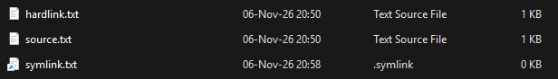
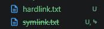
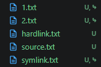
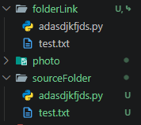
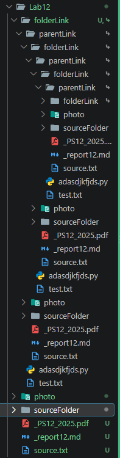

# Lab 12: File System and Implementation

## 12.1: Symbolic and hard Link

### Linux

### Window

#### `mklink`

```bash
Creates a symbolic link.

MKLINK [[/D] | [/H] | [/J]] Link Target

        /D      Creates a directory symbolic link.  Default is a file
                symbolic link.
        /H      Creates a hard link instead of a symbolic link.
        /J      Creates a Directory Junction.
        Link    Specifies the new symbolic link name.
        Target  Specifies the path (relative or absolute) that the new link
                refers to.
```

#### Create hard/soft links

- soft: `mklink symlink.txt source.txt`
- hard: `mklink /H hardlink.txt source.txt`



##### After delete the source file



- hardlink.txt still works.
- symlink.txt cannot access its deleted target and are now unaccesable.

#### Create level 1 and create level 2 link

- level1: `mklink 1.txt source.txt`
- level2: `mklink 2.txt 1.txt`



##### After delete the source file

Both level 1 and 2 link are now unaccesable.

##### After delete level 1 link

Level 2 link is now unaccesable.

#### Create a link to directory or folder.

`mklink /D folderLink sourceFolder`



#### Create a link that create a loop back to upper-level folder.

`mklink /D sourceFolder\parentLink ..`


`dir /s`

```bash
 Directory of D:\KMUTT\Year 3\Operating System\Lab12\folderLink\parentLink\folderLink\parentLink\folderLink\parentLink\folderLink\parentLink\folderLink\parentLink\folderLink\parentLink\folderLink\parentLink\folderLink\parentLink\folderLink\parentLink\folderLink\parentLink\folderLink\parentLink\folderLink\parentLink\folderLink\parentLink\folderLink\parentLink\folderLink\parentLink\folderLink\parentLink\folderLink\parentLink\folderLink\parentLink\folderLink\parentLink\folderLink\parentLink\folderLink\parentLink\folderLink\parentLink\folderLink\parentLink\folderLink\parentLink\folderLink\parentLink\sourceFolder\parentLink\folderLink\parentLink\folderLink\parentLink\folderLink\parentLink\sourceFolder\parentLink\sourceFolder\parentLink\sourceFolder\parentLink\folderLink

06-Nov-26  21:33    <DIR>          .
06-Nov-26  21:34    <DIR>          ..
06-Nov-26  21:31                 0 adasdjkfjds.py
06-Nov-26  21:33    <SYMLINKD>     parentLink [..]
06-Nov-26  21:29                33 test.txt
               2 File(s)             33 bytes

 Directory of D:\KMUTT\Year 3\Operating System\Lab12\folderLink\parentLink\folderLink\parentLink\folderLink\parentLink\folderLink\parentLink\folderLink\parentLink\folderLink\parentLink\folderLink\parentLink\folderLink\parentLink\folderLink\parentLink\folderLink\parentLink\folderLink\parentLink\folderLink\parentLink\folderLink\parentLink\folderLink\parentLink\folderLink\parentLink\folderLink\parentLink\folderLink\parentLink\folderLink\parentLink\folderLink\parentLink\folderLink\parentLink\folderLink\parentLink\folderLink\parentLink\folderLink\parentLink\folderLink\parentLink\folderLink\parentLink\sourceFolder\parentLink\folderLink\parentLink\folderLink\parentLink\folderLink\parentLink\sourceFolder\parentLink\sourceFolder\parentLink\sourceFolder\parentLink\folderLink\parentLink

06-Nov-26  21:34    <DIR>          .
06-Nov-26  21:17    <DIR>          ..
06-Nov-26  21:30    <SYMLINKD>     folderLink [sourceFolder]
06-Nov-26  21:35    <DIR>          photo
06-Nov-26  21:27                 3 source.txt
06-Nov-26  21:33    <DIR>          sourceFolder
06-Nov-26  20:07           135,428 _PS12_2025.pdf
06-Nov-26  21:35             1,469 _report12.md
               3 File(s)        136,900 bytes

 Directory of D:\KMUTT\Year 3\Operating System\Lab12\folderLink\parentLink\folderLink\parentLink\folderLink\parentLink\folderLink\parentLink\folderLink\parentLink\folderLink\parentLink\folderLink\parentLink\folderLink\parentLink\folderLink\parentLink\folderLink\parentLink\folderLink\parentLink\folderLink\parentLink\folderLink\parentLink\folderLink\parentLink\folderLink\parentLink\folderLink\parentLink\folderLink\parentLink\folderLink\parentLink\folderLink\parentLink\folderLink\parentLink\folderLink\parentLink\folderLink\parentLink\folderLink\parentLink\folderLink\parentLink\folderLink\parentLink\sourceFolder\parentLink\folderLink\parentLink\folderLink\parentLink\folderLink\parentLink\sourceFolder\parentLink\sourceFolder\parentLink\sourceFolder\parentLink\folderLink\parentLink\folderLink

06-Nov-26  21:33    <DIR>          .
06-Nov-26  21:34    <DIR>          ..
06-Nov-26  21:31                 0 adasdjkfjds.py
06-Nov-26  21:33    <SYMLINKD>     parentLink [..]
06-Nov-26  21:29                33 test.txt
               2 File(s)             33 bytes

 Directory of D:\KMUTT\Year 3\Operating System\Lab12\folderLink\parentLink\folderLink\parentLink\folderLink\parentLink\folderLink\parentLink\folderLink\parentLink\folderLink\parentLink\folderLink\parentLink\folderLink\parentLink\folderLink\parentLink\folderLink\parentLink\folderLink\parentLink\folderLink\parentLink\folderLink\parentLink\folderLink\parentLink\folderLink\parentLink\folderLink\parentLink\folderLink\parentLink\folderLink\parentLink\folderLink\parentLink\folderLink\parentLink\folderLink\parentLink\folderLink\parentLink\folderLink\parentLink\folderLink\parentLink\folderLink\parentLink\sourceFolder\parentLink\folderLink\parentLink\folderLink\parentLink\folderLink\parentLink\sourceFolder\parentLink\sourceFolder\parentLink\sourceFolder\parentLink\folderLink\parentLink\photo

06-Nov-26  21:35    <DIR>          .
06-Nov-26  21:34    <DIR>          ..
06-Nov-26  21:07             2,229 winDelSource1.png
06-Nov-26  21:01             6,890 windowLink1.png
06-Nov-26  21:31             7,557 winFolder.png
06-Nov-26  21:35            29,419 winLoop.png
06-Nov-26  21:15             3,572 winLv.png
               5 File(s)         49,667 bytes
```

it goes on for a etenity...

#### Can you create a link on drive D: to source on drive C:

## 12.2: Linux’s File Type: Named Pipe

---

## 12.3: Reading and Writing Files
